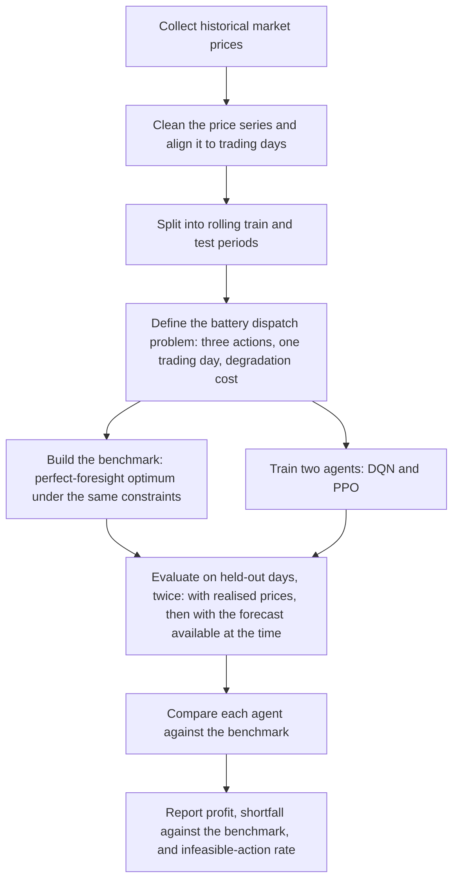
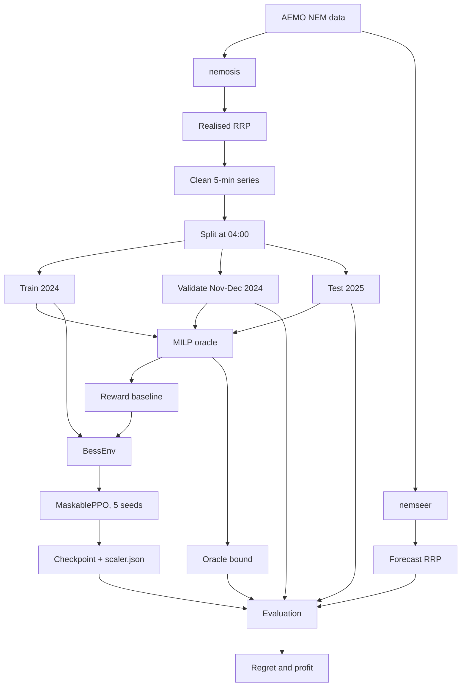
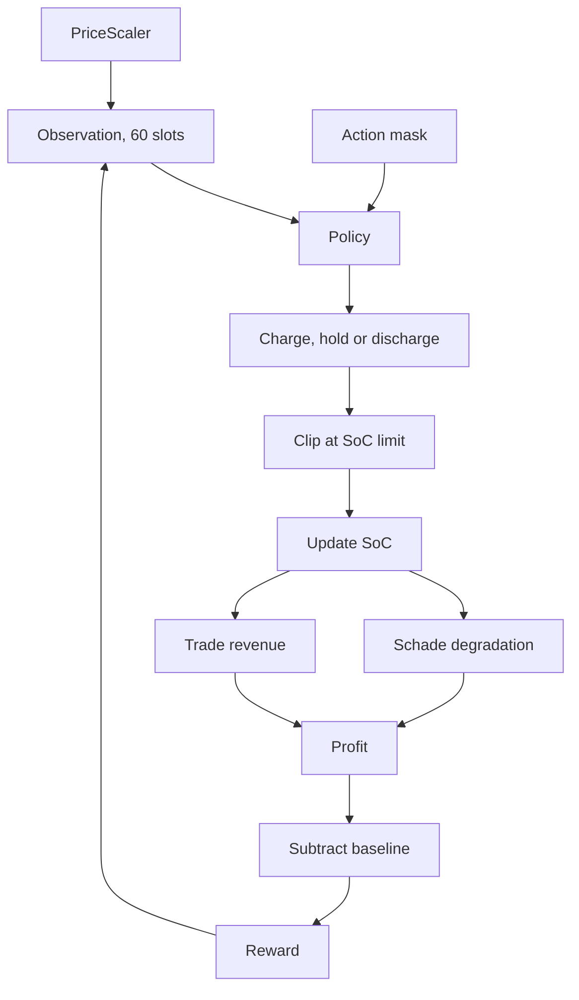
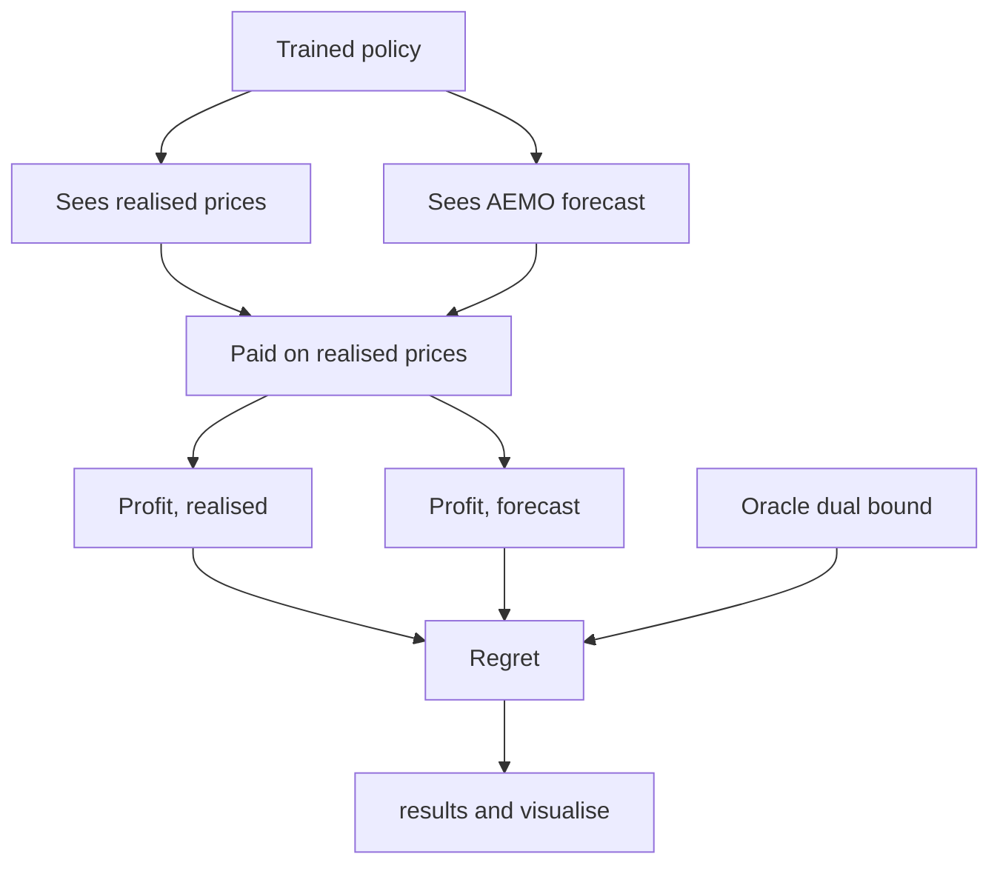

# Methodology

## Overview

The method in one figure. Each stage is described in full below.

The benchmark and the agents face the same problem. Same actions, same horizon, same
costs. This is what makes the benchmark an upper bound, so the gap to it measures the
policy and nothing else.

## Detail

Three more diagrams. The first shows the whole pipeline. The second shows one
environment step. The third shows how the agent is scored.

### Pipeline

Data enters at the top. Every window is solved twice: once by the oracle, once by the
agent.

The oracle runs in two modes. The continuous mode is cheap and gives the per-interval
reward baseline. The discrete mode uses the same three actions as the agent, so it is
the only fair bound. See `config.py`.

### One environment step

The environment and `solve(discretePower=True)` state the same problem. Same actions,
same top-up rule, same degradation terms.

The observation holds the SoC, 12 five-minute prices, 46 half-hour bucket means and the
intervals remaining. `rl/features.py` is the single definition of this layout.

### Scoring

Each policy is scored twice on the same window. The prices it sees change. The prices
it is paid on do not.

The gap between the two profits is the cost of forecast error. Quote
`Schedule.dualBound` as the bound, never `Schedule.profit`.
